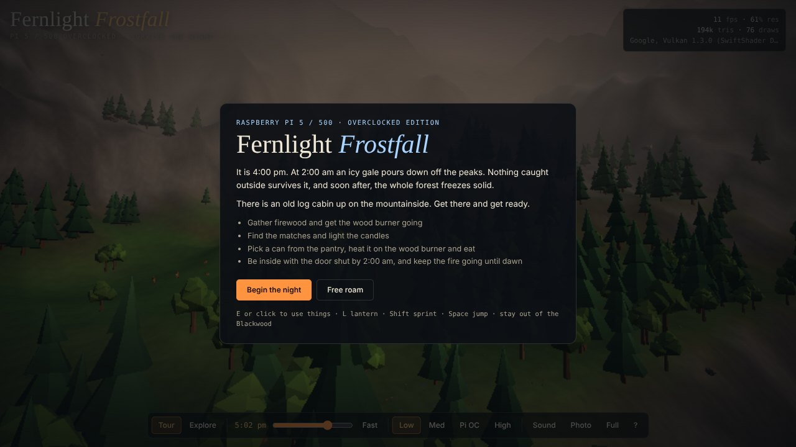
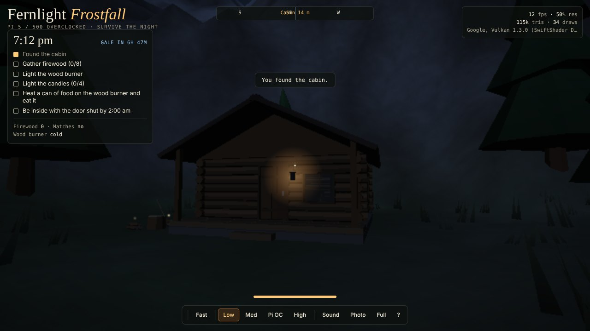
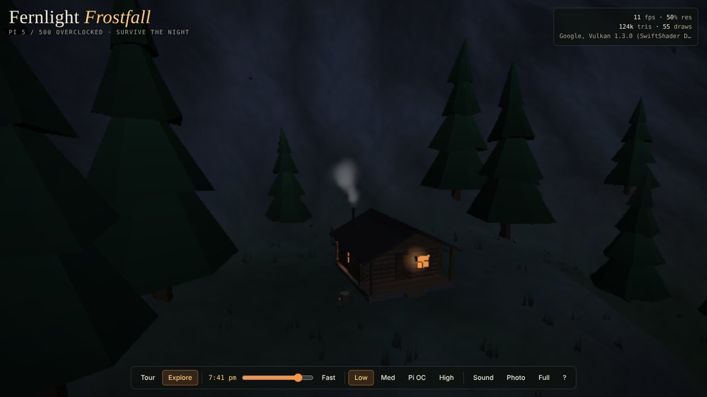
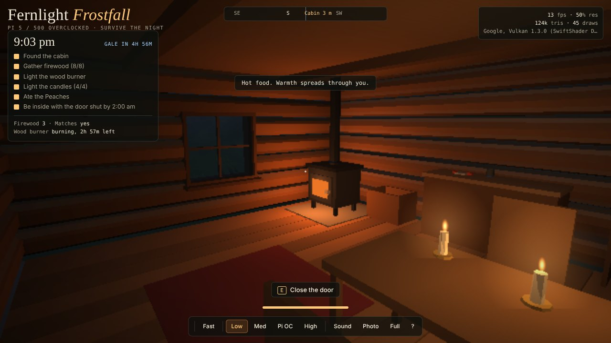
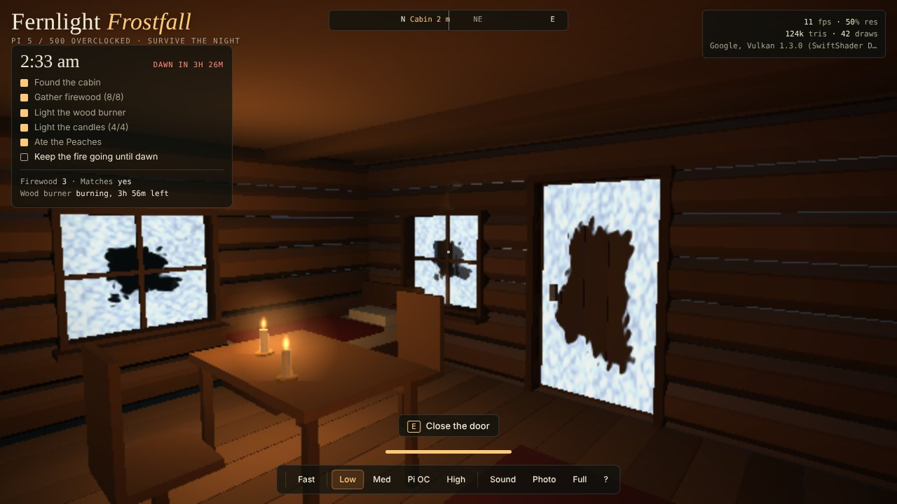
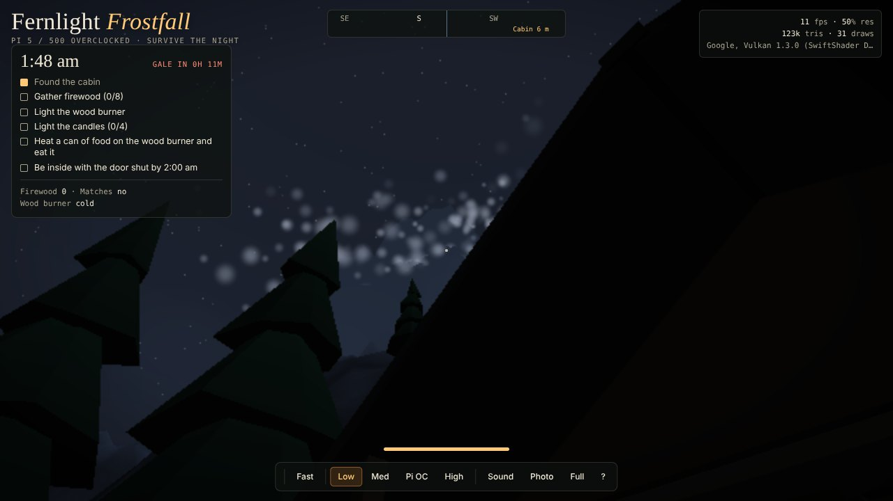
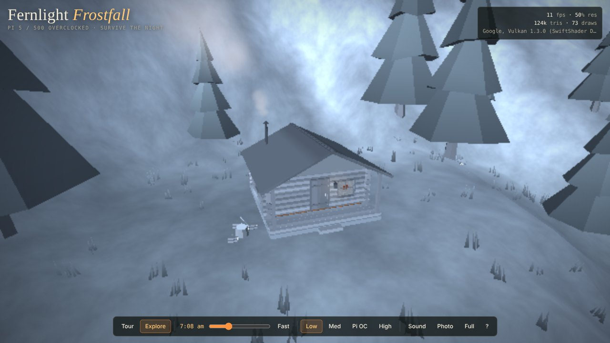
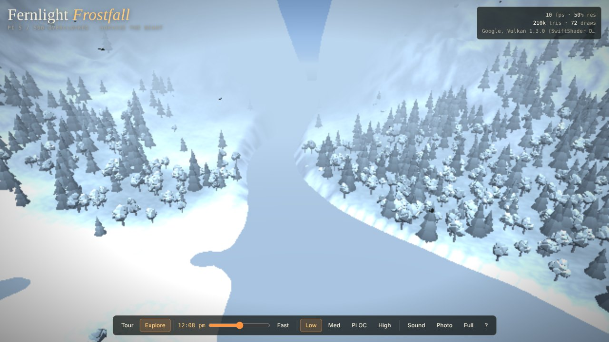

# Fernlight Frostfall

A survival version of [Fernlight Hollow](https://github.com/hardwaremack-prog/fernlight-hollow), built for an **overclocked Raspberry Pi 5 / 500**. It's one HTML file that runs offline in Chromium with no install.

> It is 4:00 pm. At 2:00 am an icy gale pours down off the peaks. Nothing caught outside survives it, and soon after, the whole forest freezes solid. There is an old log cabin up on the mountainside. Get there and get ready.

## Your goals

1. **Find the cabin** up on the mountainside. The porch lantern glows after dark.
2. **Gather 8 firewood.** Bundles are scattered around the cabin and glint faintly at night.
3. **Light the wood burner.** The matches are on the table. Smoke rises from the chimney once it's going.
4. **Light the 4 candles.**
5. **Eat a hot meal.** Pick one of 15 cans from the pantry shelf, open it with the can opener, pour it into the metal bowl, and heat it on the wood burner.
6. **Be inside with the door shut by 2:00 am**, then keep the fire fed until dawn at 6:00 am.

| | |
|---|---|
|  |  |
|  |  |

## The storm

- **From 1:30 am** a blizzard tears off the mountaintops.
- **At 2:00 am** the gale arrives. Outside you have only seconds. Leaving the cabin door open lets the cold in.
- **Soon after**, the forest crystallizes into ice from the peaks down: trees, grass, rocks, the cabin and then the river.
- **Inside the cabin**, frost creeps across the windows and the door.
- **If the wood burner goes out** during the storm, the cold finds you. Each log burns about an hour.
- **Make it to dawn** and you can walk out into a valley frozen in glass.

| | |
|---|---|
|  |  |

The Rootwalker still lives in the Blackwood, so keep away.

## Run it

1. Copy `index.html` to the Pi.
2. Open it in Chromium.
3. Turn on **Sound** for the wind, the fire and the storm.

## Controls

| Key | Action |
|---|---|
| Mouse / click | Look around. Click once to lock the mouse; Esc releases it. |
| W A S D | Walk |
| Shift | Sprint (uses stamina) |
| Space | Jump |
| E or click | Use, pick up, light |
| L | Lantern on / off |
| T | Speed up time |
| 1 2 3 4 | Low, medium, Pi OC, high detail |
| H | Hide the overlay |
| F | Fullscreen |

**Free roam** on the title screen gives you the original flying explorer with no storm.

## Tuned for an overclocked Pi 5 / 500

- When it detects the Pi's VideoCore GPU, it picks the **Pi OC** preset. That means more trees, grass, flowers and snow than Medium.
- Render resolution still adapts on its own to hold a smooth frame rate.
- Ice, frost, snow and smoke are done in lightweight shaders and particles, and the cabin's candle and stove light is calculated only on the cabin itself.

Built with [three.js](https://threejs.org) r128, which is bundled into the file.
